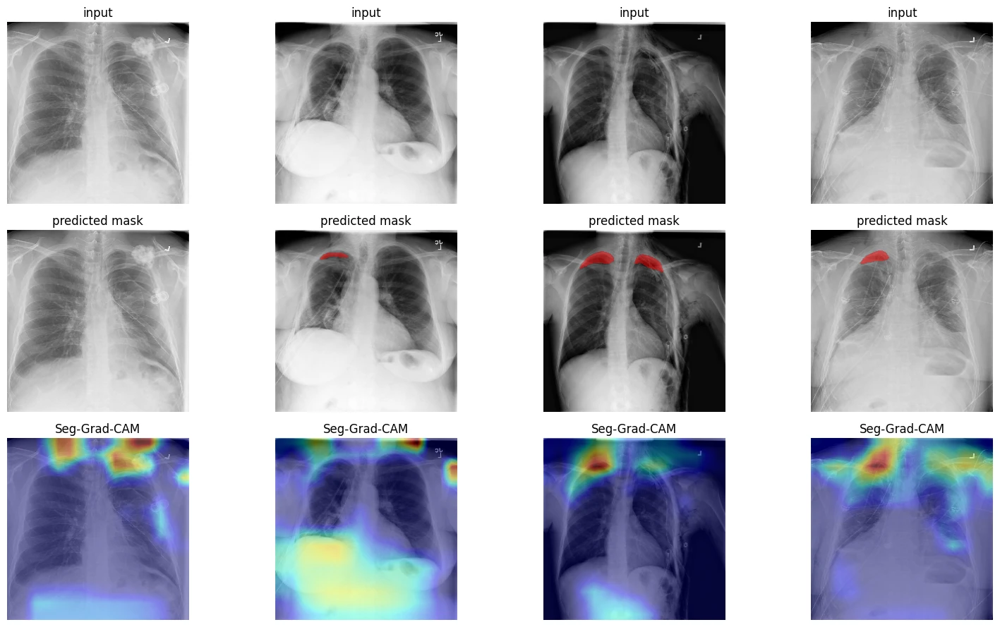
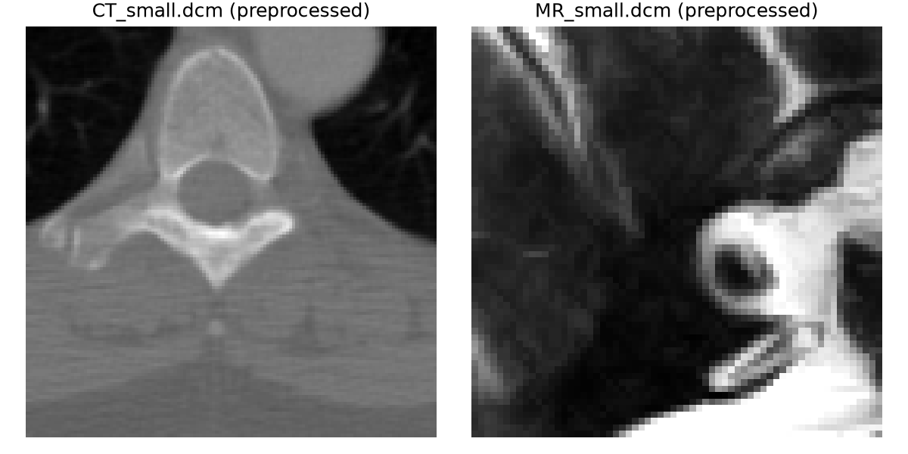
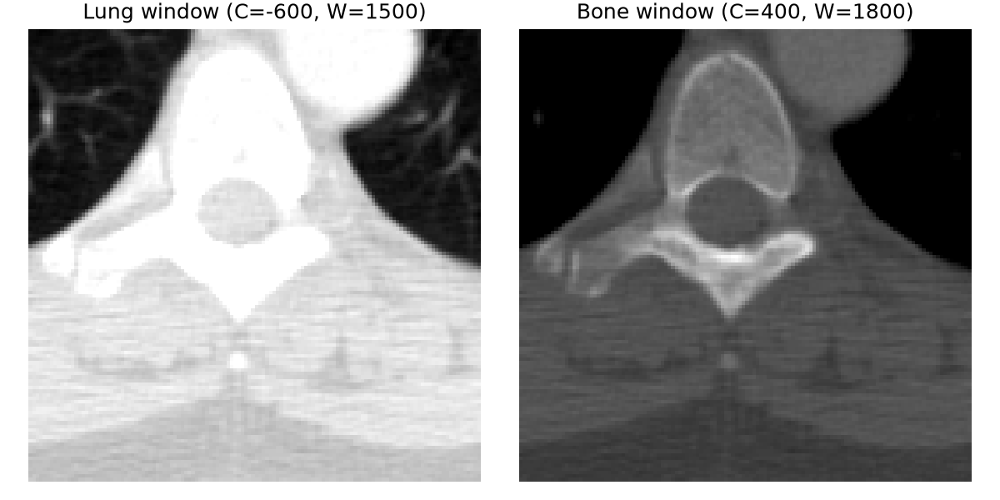
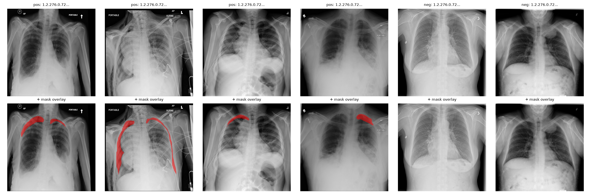

# Chest X-Ray Pneumothorax Segmentation

A lesion-segmentation model that works on **real DICOM files**, not pre-converted PNGs — with a **U-Net built from scratch** in PyTorch and **Seg-Grad-CAM explainability** showing where the model is looking.


Trained on the [SIIM-ACR Pneumothorax Segmentation](https://www.kaggle.com/c/siim-acr-pneumothorax-segmentation) dataset — a real Kaggle competition using radiologist-annotated chest X-rays, not a toy dataset.

## Results

| Model | Dice | IoU |
|---|:---:|:---:|
| Naive Otsu-threshold baseline (no learning) | 0.038 | 0.020 |
| **U-Net (this project)** | **0.121** | **0.073** |

**~3.2x Dice / ~3.6x IoU improvement over the naive baseline**, measured on pneumothorax-positive validation images. Full numbers, methodology, and an honest discussion of training-run stability are in [BENCHMARKS.md](BENCHMARKS.md).

<p align="center">
  
</p>

<p align="center"><em>Input X-ray → predicted mask → Seg-Grad-CAM attention heatmap. The model attends to the lung apex / pleural line — anatomically where pneumothorax presents.</em></p>

## Contents

- [How it works](#how-it-works)
- [DICOM preprocessing](#dicom-preprocessing)
- [CT windowing](#ct-windowing)
- [Dataset & mask decoding](#dataset--mask-decoding)
- [U-Net architecture](#u-net-architecture)
- [Loss function](#loss-function)
- [Evaluation](#evaluation)
- [Seg-Grad-CAM explainability](#seg-grad-cam-explainability)
- [Training on Colab](#training-on-colab)
- [Testing](#testing)
- [Getting started](#getting-started)
- [Project structure](#project-structure)
- [What's next](#whats-next)

## How it works

```
DICOM file ──► preprocessing.py ──► U-Net ──► predicted mask
  (raw)        (LUT correction,      (from        + Seg-Grad-CAM
                windowing, resize)    scratch)       heatmap
```

Raw DICOM pixel data isn't display-ready or model-ready — it needs metadata-driven rescaling before it means anything. Everything below, from pixel correction to explainability, is built from first principles rather than a library wrapper: no `segmentation_models_pytorch`, no third-party Grad-CAM package.

## DICOM preprocessing

A DICOM file is not "an image with some extra tags" — the pixel data on its own is not display-ready. [`dicom_seg/preprocessing.py`](dicom_seg/preprocessing.py) implements the correct pipeline:

1. **Read the pixel data.** `ds.pixel_array` gives raw stored integers — not calibrated to any physical unit yet.
2. **Apply the Modality LUT** (`RescaleSlope` / `RescaleIntercept`, or a LUT Sequence). For CT this converts stored values into Hounsfield Units (HU); for X-ray it's close to identity, but still the correct step to apply first.
3. **Apply the VOI LUT / default window** (`WindowCenter` / `WindowWidth`), if present, for display-ready contrast.
4. **Correct for `PhotometricInterpretation`.** Most images are `MONOCHROME2` (low value = dark). Some are `MONOCHROME1` (low value = **bright**) — get this backwards and every image renders as a photographic negative.
5. **Normalize** to `[0, 1]` or `[0, 255]`.

<p align="center">
  
</p>

Both render with correct orientation and contrast — not inverted, not blown out. Regenerate with `python scripts/milestone1_2_demo.py` (uses pydicom's bundled sample files, no external dataset needed).

## CT windowing

CT stores intensities in Hounsfield Units across a huge range (air ≈ -1000 HU, dense bone up to +3000 HU) — too wide for any display to show with good contrast at once. **Windowing** picks a **center** and **width**, stretches that slice across the full display range, and clips everything outside it.

<p align="center">
  
</p>

`apply_window(image_hu, center, width)` in [`dicom_seg/preprocessing.py`](dicom_seg/preprocessing.py) implements this — same CT slice, two windows: **lung** (C=-600, W=1500) saturates bone to white but maximizes soft-tissue contrast; **bone** (C=400, W=1800) reveals trabecular detail at the cost of soft tissue. Chest X-ray isn't HU-calibrated, so this matters less for the primary dataset here — but the concept (and this code) would matter immediately if the pipeline were fed CT input instead.

## Dataset & mask decoding

[`dicom_seg/rle.py`](dicom_seg/rle.py) decodes SIIM's column-major, delta-encoded RLE mask format (ported from Kaggle's official reference implementation, with the width/height transpose applied — forgetting that transpose is the classic bug for this dataset). [`dicom_seg/dataset.py`](dicom_seg/dataset.py) builds a manifest pairing each DICOM with its mask, does a stratified train/val split, and wraps it in a `torch.utils.data.Dataset`.

**Data:** 400 images from SIIM-ACR (200 pneumothorax-positive, 200 negative), pulled via the Kaggle API from a re-hosted copy that preserves original DICOM filenames matching the label CSV — the official competition's own downloadable files turn out to be the anonymized *test* set, which doesn't match the labels at all.

<p align="center">
  
</p>

Red regions sit at the lung apex / pleural line — exactly where a pneumothorax (partially collapsed lung) shows up, confirming the RLE decode and axis handling are correct, not transposed or offset. (Overlaying decoded masks on their source image is the cheapest way to catch a misaligned mask — the single most common silent bug in segmentation projects.)

## U-Net architecture

[`dicom_seg/unet.py`](dicom_seg/unet.py) implements the encoder-decoder with skip connections directly in PyTorch. Skip connections concatenate each encoder stage's feature map onto the decoder at the same resolution, before that decoder block's convs — this is what lets the network recover fine spatial detail lost during downsampling; without them the output is a blurry, low-resolution guess upsampled back to full size.

~31M parameters at the default `features=[64,128,256,512]` config. Verified with parametrized input/output shape tests (64/128/256, single- and multi-channel input), an autograd smoke test, and an end-to-end run of a real `DataLoader` batch through the model.

## Loss function

[`dicom_seg/losses.py`](dicom_seg/losses.py): `DiceBCELoss` combines soft Dice loss (a direct overlap measure that stays informative when the foreground region is small) with BCE (a stable per-pixel gradient) — the standard recipe for imbalanced binary segmentation, where plain BCE alone would let the model get deceptively low loss by predicting an almost-empty mask.

## Evaluation

[`dicom_seg/metrics.py`](dicom_seg/metrics.py): Dice coefficient and IoU, hand-verified (identical masks → 1.0, disjoint masks → 0.0). [`dicom_seg/baseline.py`](dicom_seg/baseline.py): a naive Otsu-thresholding segmenter with **no learning at all**, as the "did the complexity earn its keep" comparison point — see [Results](#results) above and [BENCHMARKS.md](BENCHMARKS.md) for the full breakdown, including an honest discussion of validation-metric noise across training epochs.

## Seg-Grad-CAM explainability

Grad-CAM was originally defined for classification — it backpropagates a predicted *class score*. Segmentation has no single class score, so [`dicom_seg/gradcam.py`](dicom_seg/gradcam.py) adapts it: sum the predicted mask's *logits* (pre-sigmoid, so gradients don't vanish at saturated confidence) over a region of interest, weight the target layer's activations by the averaged gradient per channel, ReLU (only positive influence counts), and upsample to the input size — applied to whichever conv layer you hook (the bottleneck, or an encoder stage).

Verified mechanically against an untrained model (hooks fire, gradients flow, shapes correct) before training; real examples from the trained model are in the [Results](#results) section above.

## Training on Colab

This laptop's GPU can't handle real training, so [`notebooks/train_colab.ipynb`](notebooks/train_colab.ipynb) is fully self-contained: it writes out the exact `dicom_seg/*.py` files from this repo (kept in sync via `scripts/build_colab_notebook.py`), downloads the same 400-image subset (same seed, same UIDs) used for the local baseline benchmark, trains the U-Net, plots loss/Dice curves, evaluates against the naive baseline on the same validation split, and generates Seg-Grad-CAM examples.

Open it in Colab, set the runtime to a T4 GPU, and run top to bottom — it'll prompt for your `kaggle.json` the first time it needs it.

## Testing

```bash
pytest tests/ -v
```

**57 tests** covering DICOM preprocessing, Modality LUT correction against hand-computed HU conversions, `MONOCHROME1` inversion (verified against a synthetic in-memory DICOM dataset, not a file on disk that happens to have that property), RLE mask decoding, dataset/manifest building, U-Net shape correctness, loss and metric functions against hand-computed examples, and Grad-CAM mechanics.

## Getting started

```bash
python -m venv .venv
.venv/Scripts/activate   # or source .venv/bin/activate on Linux/Mac
pip install -r requirements.txt
pytest tests/ -v
```

## Project structure

```
dicom_seg/           core package
├── preprocessing.py   DICOM loading, metadata, LUT correction, windowing
├── rle.py             SIIM RLE mask decode/encode
├── dataset.py         manifest building, train/val split, PyTorch Dataset
├── unet.py            U-Net from scratch
├── losses.py          combined Dice + BCE loss
├── metrics.py         Dice / IoU
├── baseline.py        naive Otsu-threshold baseline
└── gradcam.py          Seg-Grad-CAM

tests/                57 pytest tests, one file per module above
scripts/              demo/eval scripts + Colab notebook builder
notebooks/            self-contained Colab training notebook
outputs/              generated result images
BENCHMARKS.md         full evaluation numbers and methodology
```

## What's next

- [ ] Optional FastAPI + minimal viewer (upload a DICOM, see the predicted mask + heatmap)
- [ ] CI running the test suite on every push
- [ ] More training data / early stopping to reduce validation-metric noise (see [BENCHMARKS.md](BENCHMARKS.md))
- [ ] 3D volumetric CT support (this project is intentionally scoped to 2D slices)
